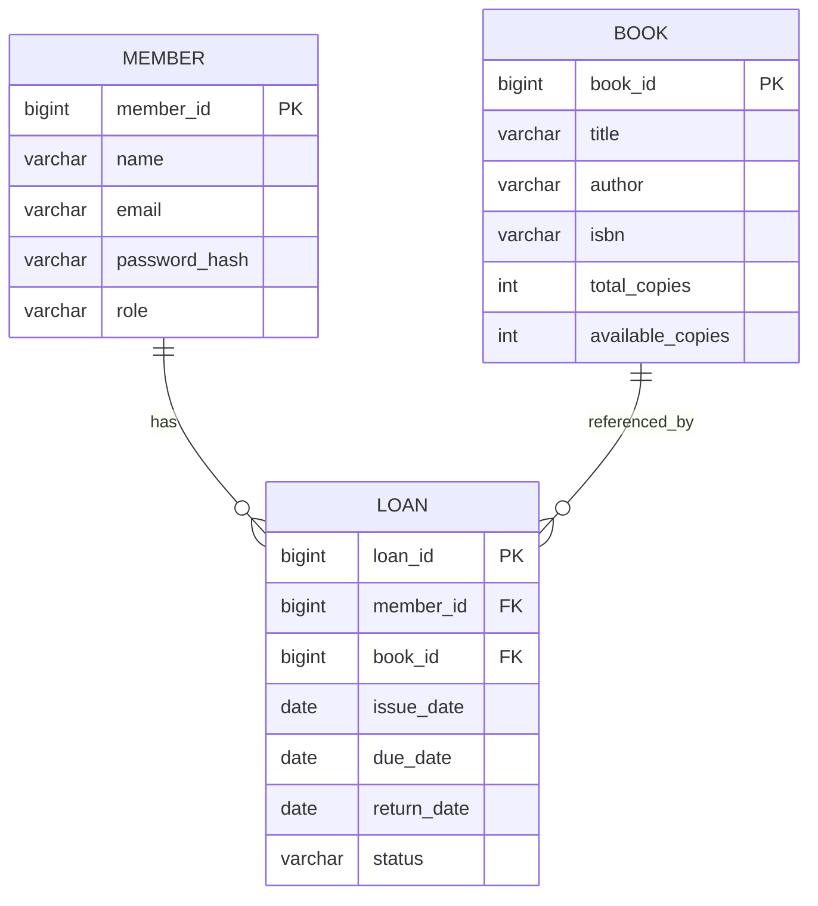

# Library Management System — ER Diagram

## 1. Entities

* **Book:** `book_id`, `title`, `author`, `isbn`, `total_copies`, `available_copies`
* **Member:** `member_id`, `name`, `email`, `password_hash`, `role`
* **Loan:** `loan_id`, `book_id`, `member_id`, `issue_date`, `due_date`, `return_date`, `status`

## 2. ER Diagram

## 3. Relationships

* One member can have multiple loan records.
* One book can be associated with multiple loan records over time.
* Each loan belongs to one member and one book.

## 4. Design Notes

* `PK` means Primary Key; `FK` means Foreign Key.
* `status` represents the loan's current state; allowed values require design confirmation.
* Loan history must be retained.
* Final attributes, data types, and constraints require mentor review.

**Review Status:** Pending Mentor Review
